<h1 align="center">
  <a href="https://aoricloud.github.io/lydite/"></a>
</h1>

**Lydite runs coding agents (called *hands*) on your repository, each hand's commands behind a sandbox wall, replays
your proof command itself, and opens a pull request only for what passed, with a receipt.** The agents' word is never
the proof.

- **Only what passed reaches the pull request.** Lydite replays your proof itself, for each task and after every
  merge; a task that stays red (one retry at most) is set aside, not merged.
- **The hands' commands run behind a wall**, a sandbox that limits what they read, write and reach on the network.
  By default, if the wall does not start, no hand starts.
- **Each pull request opens with a receipt**: the hands, their retries, the tasks set aside, the seal of the run's
  journal. After a review, the body can also list what the reviewer says was not replayed (ten lines at most, long
  lines cut).

**Install** on Linux x86-64 (or WSL2), then check your setup:

```bash
gh release download --repo aoricloud/lydite --pattern 'lydite-*-linux-x86_64.tar.gz*'
gh attestation verify lydite-*-linux-x86_64.tar.gz --repo aoricloud/lydite    # or: sha256sum -c lydite-*.tar.gz.sha256
tar -xzf lydite-*-linux-x86_64.tar.gz && mkdir -p ~/.local/bin && install -m 755 lydite-*-linux-x86_64/lydite ~/.local/bin/
lydite doctor
```

A wave also needs `git`, `gh` logged in, Claude Code signed in (or another provider's key), the wall's `srt` and an
accepted profile: [Try it](#try-it) goes on from there to your first pull request, and `lydite doctor <profile>` says
what is missing.

<p>
  <a href="https://aoricloud.github.io/givre-lab/"></a>
  <a href="https://aoricloud.github.io/mycelium-lab/"></a>
</p>

*Two simulators whose code was written by Lydite's hands, pull request after pull request:
[Givre Lab](https://github.com/aoricloud/givre-lab) (crystal growth) and
[Mycelium Lab](https://github.com/aoricloud/mycelium-lab). Click an image to run it in your browser.*

Lydite is the foreman that proves. Each hand works in its own git worktree, its commands behind the same wall; the
hand's Claude Code session itself runs on your machine, outside the wall. Lydite replays your proof itself, after every
merge, and returns a pull request with its receipt: what was replayed, what the review could not see replayed, and the
seal of the run's journal. A hand that finds that no honest code can pass your proof says so, and its task is set
aside with the hand's reason, instead of a blind fix. The hands run in Claude Code, on any model that speaks
Anthropic's API format (Claude, DeepSeek…), with no Claude account needed for another provider. You launch Lydite from
a shell, from Claude Code or another agent, or from Hermes, whatever model your Hermes runs.

The *wall* is Claude Code's sandbox (`srt`): it confines what each hand's commands can read, write and reach on the
network. A *wave* is one launch: an objective, its tasks, one pull request.

Instead of srt, a profile can choose Lydite's own *native wall* (`mur = natif`) for the wall check and the replay of
your proof; the hands' commands stay under Claude Code's sandbox. See [Native wall](#native-wall-optional).

> [!NOTE]
> **Status: early.** Lydite builds itself and two public test repositories (the *benches*); nobody else has run it
> yet. It is a small Rust program with no crate dependencies. What it prints is mostly in English; what is still in
> French is listed under [Where it stands](#where-it-stands), and the keys of profiles and plans are among it (`sorte`,
> `modele`; a table below translates the words you need). The wall only works on Linux. A wave runs Claude Code
> sessions on your own account or provider key. Expect rough edges.

## What a Lydite pull request says

This is the body of [#98](https://github.com/aoricloud/lydite/pull/98), the pull request that added `lydite skill`,
abridged (`[…]`). Lydite wrote it. The task's text and the reviewer's lines are in French: we write our plans in
French, and Lydite still instructs its reviewer in French.

```text
Receipt
[…]
- 2 hands, 0 retries, 0 set aside
- Effort: hand: high; reviewer: high
- Thread sealed at 527750 bytes: sha256 434c57d7[…].
- Proof settings changed: none

Serve the skill that says how to drive Lydite from the binary itself (lydite skill), always at the binary's version

Proof: cargo test && cargo clippy --all-targets -- -D warnings && cargo fmt --check && python3 […] → green

skill-servie-par-le-binaire: […]                       the task, as the plan wrote it

Points to justify (found by Lydite without a model):
- `hermes/tests/test_skill.py`: a test of the base changed (4 lines removed)

Review: 2 remarks, 0 blocking.
Reviewed and replayed on commit 464e455677e5504496ebb50ad88a37d879d2d867.
Not replayed (from the review):
[…]                                                    ten lines, in French; they say that nothing replayed shows
                                                       the hand made the new test fail on purpose, and that the
                                                       proof ran on Linux only, never on Windows
```

The receipt counts the hands, their retries and the tasks set aside, and seals the journal of the run (the *thread*).
Four more things to notice. The proof line is your command, run again by Lydite after the hands have finished, not by
them. The points to justify are found by Lydite itself, without a model: here a test of the base lost lines, and the
reviewer had to say why. The commit line names the exact commit that was replayed (and reviewed, when the plan marked
a task critical): on this repository, the CI check `tete` fails for a pull request whose branch is named `lydite/…`
unless its head's files are those of a commit named as replayed after a review, in its body or in a correction merged
into its branch; a pull request from any other branch passes it unchecked. And the last block is what the review could
**not** see replayed. Lydite prints it.

As of 11 November 2026, on our own repositories:

| Repository | Pull requests by Lydite with a receipt, merged | Hands | Retries | Tasks set aside |
|---|---|---|---|---|
| [lydite](https://github.com/aoricloud/lydite/pulls?q=is%3Apr+is%3Amerged) (it builds itself) | 69 | 212 | 7 | 0 |
| [mycelium-lab](https://github.com/aoricloud/mycelium-lab/pulls?q=is%3Apr+is%3Amerged) | 30 | 140 | 1 | 0 |
| [givre-lab](https://github.com/aoricloud/givre-lab/pulls?q=is%3Apr+is%3Amerged) | 37 | 204 | 7 | 1 |

These figures are read from the receipts in the pull request bodies. The hands ran on Claude models and on DeepSeek.

## What Lydite refuses to do

Each refusal has a number, says what it saw, and says what to do.

- **Lydite itself never merges.** It opens the pull request and reads its CI. Merging is your rule. (On our two
  benches, the repository's own workflow asks GitHub to auto-merge a head Lydite replayed, once the CI is green on
  Linux and Windows. On Lydite itself, a pull request is merged by hand.)
- **It never takes a hand's word.** A hand ends its report with a `PREUVE:` line, its own word on its proof. Lydite
  replays your proof itself; without `--verify`, that word is all there is, and the work stays declared. A fact a hand
  only declared is shown as declared, never as observed.
- **It starts nothing if your proof is already red** on the base commit (6022): a red proof proves nothing afterwards.
- **It starts nothing if the wall does not start** (6028): before any hand, it runs a command under the wall that
  replays your proof (your `srt`, or the native wall under `mur = natif`). That check shows the wall starts, not what
  it closes, and it does not try the sandbox Claude Code starts for each hand: that one is required as each hand
  starts, and a hand that Claude Code reports outside it is stopped before its task. It takes no issue as input
  without the wall (6029): an issue is text from outside.
- **It keeps a hand inside its task**: a change outside the task's list of files (7013), to a protected path or a
  lesson (7018), or to a `.claude/` folder (7006) is refused; a hand does not run `git commit` (Lydite commits).
- **It does not push a hand to cheat.** A hand that finds a test no honest code can pass says `IMPOSSIBLE: <reason>`;
  Lydite sets the task aside, replays nothing, retries nothing and merges nothing from it. The reason is the hand's
  word, shown as `impossible (declared)` and never checked: a task set aside this way does not show that the test is
  wrong, and a finding that comes back not proved does not show that there is no flaw.
- **It does not publish** a change under `.github/`, a path of your machine, or a line of your `garde` file (8005),
  nor take a pull request whose CI stays silent (8008). The `garde` file, in the state folder, holds one word or name
  per line (`#` starts a comment), matched without case: write your private names there. Without it, only `.github/`
  and the paths are checked, so we recommend writing one.
- **It never opens your Claude login file**, and puts no provider key in a profile or a pull request (see below).

What it does not do for you: a green proof is worth what your proof is worth. Lydite replays it and flags, without a
model, a test of the base that lost lines and an assertion or a tolerance that was removed or changed ("Points to
justify" in the pull request). It does not judge whether your tests are good.

[docs/refusals.md](https://github.com/aoricloud/lydite/blob/main/docs/refusals.md) lists every refusal code with its
rule.

## How a wave goes

1. You give an objective (or an issue) and **the command that proves the work done**.
2. A hand splits it into tasks; Lydite reads the plan itself. With `--dry-run` it stops here and shows the plan.
3. Each task goes to a hand in its own git worktree and branch; the hand's commands run behind the wall, with a
   filtered network exit.
4. When a hand says it is done, Lydite replays your proof itself, in a new sandboxed process. Green: the work is
   merged into the wave's branch, and the proof is replayed after every merge. Red: one retry, with the error given to
   the hand, then the task is set aside.
5. The tasks a plan marks critical are reviewed by another hand, which gets the diff and the replayed proof, and must
   say what was replayed and what was not.
6. Lydite pushes the branch, opens the pull request with its receipt, and reads the CI. If the CI is red and no task
   was marked critical, one hand corrects what the CI reported, once; otherwise the pull request stays open and red
   (8011).

Everything that happens is appended to a journal outside the repository (the *thread*), sealed by its SHA-256 before
the pull request is written. `lydite status` reads it back and recomputes every seal.

## Try it

**What it takes.** Linux on x86-64 (or WSL2 on Windows), about an hour the first time, and Claude Code sessions on
your own account or provider key: even looking at a plan runs one hand.

| | Why | How |
|---|---|---|
| `git`, and `gh` logged in | the pull request | `gh auth status`. To verify the download you need `gh` 2.67 or later; Debian 13's packaged 2.46 has no `gh attestation` (use the `.sha256` file instead) |
| [Claude Code](https://claude.com/claude-code), signed in | the hands | Lydite reads Claude Code's output in a precise form, checked on 2.1.312 to 2.1.317; another version may break it |
| Node and npm; `srt` | the wall | `sudo apt install bubblewrap socat ripgrep`, then `sudo npm install -g @anthropic-ai/sandbox-runtime`. Its current version (0.0.81) needs Node 22.12 or later; with Debian 13's Node 20, install `@anthropic-ai/sandbox-runtime@0.0.78`, the version we run. Install it outside your home folder: the wall closes your home, and an `srt` under it fails with 6028 unless a `lecture` line of the profile opens its folder. `LYDITE_SRT` names an `srt` that is not on your `PATH`. On Ubuntu 24.04 and later, see the sandbox runtime's note on AppArmor and user namespaces. With `mur = natif`, Lydite neither looks for nor runs `srt`, but the hands' commands still run in Claude Code's sandbox, which needs bubblewrap and socat according to its [sandboxing page](https://code.claude.com/docs/en/sandboxing): keep the `apt install` above, with which we ran it (Debian 13, Claude Code 2.1.317; see [Native wall](#native-wall-optional)) |
| a target repository | the work | on GitHub, with a branch you may push to, a CI that runs on pull requests, and a proof command that is green today |

**Install.** Download the archive, verify it was built by this repository's GitHub Actions, and put the binary on your
`PATH`:

```bash
gh release download --repo aoricloud/lydite --pattern 'lydite-*-linux-x86_64.tar.gz*'
gh attestation verify lydite-*-linux-x86_64.tar.gz --repo aoricloud/lydite    # or: sha256sum -c lydite-*.tar.gz.sha256
tar -xzf lydite-*-linux-x86_64.tar.gz
mkdir -p ~/.local/bin && install -m 755 lydite-*-linux-x86_64/lydite lydite-*-linux-x86_64/lydite-reseau ~/.local/bin/
```

Or build it: `cargo build --release`, and `cargo build --release --manifest-path reseau/Cargo.toml` for `lydite-reseau`, which only the native wall needs (the toolchain is pinned by `rust-toolchain.toml`).

**Check your setup.** Run `lydite doctor`: it launches no hand, writes nothing, and says for `git`, `gh`, Claude Code,
`srt` and the state folder whether they are in order. Then, from your repository once the profile is accepted, run
`lydite doctor <profile>`: it also reads the profile and plays the wall check (the only thing it writes). Every
`missing` line says what to do. Without a profile, `ready` means the wall was not tried: only the run with your
profile plays it. With a profile, its line ends with `wall checked` only under `mur = exige` or `natif`; under
`mur = demande` (on Windows, say), `ready` says nothing of the wall. `LYDITE_GH`, `LYDITE_CLAUDE` and `LYDITE_SRT`
name a `gh`, `claude` or `srt` that is not on your `PATH`.

**A profile** says what the hands are lent. Write `~/.local/state/lydite/profils/first.profil` (the default state
folder; `LYDITE_DOSSIER` moves it). This one is for a Rust project:

```text
sorte = claude
modele = sonnet
relance = sonnet
# the hands that split and review use opus unless you say otherwise
decoupeur = sonnet
relecteur = sonnet
mur = exige
# the wall closes your home folder: open what your proof's tools need to read there
lecture = ~/.cargo, ~/.rustup
delai_main = 3600
delai_preuve = 300
```

The hands that split an objective and review a task check their work with `lydite` itself, behind the wall, which
closes your home folder. Under a required wall (`mur = exige` or `natif`), Lydite lends every hand's commands, and the
replay of your proof, the real file of its own executable (links followed; that file must be named `lydite`), that
file only and never its folder, so a `lydite` installed under your home folder, as above, runs there with nothing in
`lecture`. Under `mur = demande` nothing more is lent: those checks run outside the sandbox and find it anyway.

A proof that downloads something (dependencies, say) also needs a `reseau` line naming the domains it may reach.

```bash
lydite accept first       # shows the profile and accepts its fingerprint; a changed profile must be accepted again
lydite profile first      # read-only: what Lydite understood (models, efforts, wall, ceiling, timeouts)
```

**Look at a plan first.** Run this from your repository: it checks the wall, checks that your proof passes on the
base, runs one hand that splits the objective into tasks, prints the plan, and stops.

```bash
lydite launch first "Add a test for the empty-input case of parse()" --split --verify "cargo test" --dry-run
```

**Then run the wave** and get a pull request against `main`:

```bash
lydite launch first "Add a test for the empty-input case of parse()" --split --verify "cargo test" --pr main
lydite status             # where the last wave stands; `lydite wait` waits for a running one
```

Progress and the pull request's address are printed as the wave goes. `launch` exits 0 only if every task was taken,
its proof replayed green and, with `--pr`, the pull request's CI green; 1 otherwise, a split Lydite did not take
included; and 2 for a refusal before anything started. [Commands](#commands) gives every command's exit codes.

**A ceiling per hand.** Each hand has a ceiling, `plafond` (20 dollars by default), enforced by Claude Code: a hand
that reaches it is stopped, and its task comes back to you. With another provider (`api`) it may never trigger.

**The French words left in a profile or a plan:**

| Word | Meaning |
|---|---|
| `sorte`, `modele`, `relance` | profile: kind of hand, its model, the model of the retry |
| `decoupeur`, `relecteur` | profile: the models of the hand that splits an objective and of the hand that reviews |
| `mur = exige` / `demande` / `natif` | the wall is required (srt replays your proof) / only requested / required, and Lydite's native wall replays your proof (see "Native wall") |
| `lecture`, `reseau` | paths the hands' commands may read, domains they may reach |
| `plafond` | the most one hand may spend, in dollars |
| `delai_main`, `delai_preuve` | how long a hand, and a replay of your proof, may run, in seconds |
| `api`, `cle`, `prix` | another provider: its URL, the name of the variable that holds its key, its prices |
| `proteges`, `efforts_permis` | paths no hand may change; the efforts a plan may ask (see [A profile](#a-profile)) |
| `tache`, `objectif`, `preuve`, `fichiers`, `depend`, `critique` | plan: a task, its objective, its proof, its files, the tasks it waits for, whether it is reviewed |

The French commands and flags of earlier versions (`lancer`, `--verifier`, `--depot`…) are still read.

**Another provider.** Any API in Anthropic's format works, with no Claude account. The profile names the URL and the
*name* of the environment variable that holds your key, never the key:

```text
sorte = claude
api = https://api.deepseek.com/anthropic
cle = DEEPSEEK_API_KEY
modele = deepseek-flash
relance = deepseek-flash
decoupeur = deepseek-flash
relecteur = deepseek-flash
mur = exige
```

Set `decoupeur` and `relecteur` too: they default to `opus`, a name your provider may not know. An optional `prix`
line gives the provider's prices, so that receipts carry a cost.

**Windows.** The wall (the sandbox) is required everywhere, Windows included: a profile with no `mur` line, and the built-in `claude` profile, require it. But Claude Code's sandbox and srt do not hold under Windows, so the wall check fails there (6028) before any hand. To launch anyway, knowingly, write `mur = demande` in the profile (for the built-in profile, a file `profils/claude.profil` that repeats its text with `mur = demande`), then `lydite accept <name>`. Under a requested wall the hand's commands may run outside Claude Code's sandbox and see the provider's key if there is one, and the proof is replayed outside the wall. Lydite also refuses `--issue` there (6029), and replays your proof through `cmd /C`. WSL2 gives you the Linux path, wall included.

For that use, each release also has a Windows build: download it with `gh release download --repo aoricloud/lydite
--pattern 'lydite-*-windows-x86_64.zip*'`, verify it with `gh attestation verify` as above (or compare `Get-FileHash`
with its `.sha256` file), unzip it, and put `lydite.exe` on your `PATH`.

## Where it stands

**Works today**, each seen in a public pull request:

- A wave from a plan, and its pull request with a receipt
  ([givre-lab#29](https://github.com/aoricloud/givre-lab/pull/29)).
- A review that judges on the replayed proof and names the commit; on this repository's own pull requests, a merge
  check that refuses a head Lydite did not replay after a review, on a branch named `lydite/…` (any other branch
  passes unchecked). It reads that commit from the pull request body: a line of text, not a signature
  ([#21](https://github.com/aoricloud/lydite/pull/21), [#22](https://github.com/aoricloud/lydite/pull/22),
  [mycelium-lab#47](https://github.com/aoricloud/mycelium-lab/pull/47)).
- The honest way out, `IMPOSSIBLE` ([#6](https://github.com/aoricloud/lydite/pull/6)); protected paths and the exact
  text of a plan ([#14](https://github.com/aoricloud/lydite/pull/14)).
- The sealed thread ([#21](https://github.com/aoricloud/lydite/pull/21)); written lessons given to each hand
  ([#26](https://github.com/aoricloud/lydite/pull/26)).
- Commands that launch no hand: `lydite doctor` checks a machine before the first wave
  ([#74](https://github.com/aoricloud/lydite/pull/74)), `lydite wait` waits for a running one
  ([#33](https://github.com/aoricloud/lydite/pull/33)), and `lydite skill` prints the skill an agent follows to drive
  Lydite ([#98](https://github.com/aoricloud/lydite/pull/98)). Every refusal is listed with its rule in
  [docs/refusals.md](https://github.com/aoricloud/lydite/blob/main/docs/refusals.md)
  ([#80](https://github.com/aoricloud/lydite/pull/80)).
- Linux and Windows builds, with binaries attested by GitHub Actions; the tests run on both in CI, against a stand-in
  for Claude Code.

**Partly there:**

- Windows: only with `mur = demande`, knowingly. The wall does not hold there: the hands' commands run outside the
  sandbox and see a provider key if there is one. No `--issue`.
- English: the commands and their flags, the help, the rule of every refusal, `lydite status`, `lydite doctor`, the
  pull request body, this README and the Hermes plugin (not its tool names, such as `lydite_lancer`). Still in French:
  what a refusal saw and its fix when it comes from reading a plan, a profile, the thread or a hand's report, or from
  the wall; the lines `lydite launch` prints as the wave goes (`assemblée`, `classée`, `branche de la vague`…); the
  keys of profiles and plans; the names of the refusal codes (`lancer.dossier_pris`); a few fixes that still name a
  command by its French name (`lydite accepter`, still read); and the instructions Lydite gives
  its hands, so a reviewer's lines in a pull request usually come out in French too.
- The Hermes plugin: Linux only.
- The native wall (`mur = natif`), Linux only: it holds the wall check and the replay of your proof, not yet the
  hands' commands, which stay under Claude Code's sandbox. srt stays the default.
- Providers: we run Claude and DeepSeek. The format allows others; we have not run them.
- Anyone but us: Lydite has only run on our own three repositories.

**Not there yet:** a start guide replayed on a fresh machine; reference pages for profiles, plans and the thread;
binaries for macOS and ARM; a judge for tests that prove nothing.

Lydite is designed so that a human decides in five cases only: merging into `main`, putting something on a real system,
spending beyond a quota, giving root, and publishing.

## Claude Code and your accounts

Lydite runs the Claude Code you installed (`claude`), as Anthropic publishes it, with its documented options: it
patches nothing and has no sign-in of its own. Each person signs in to Claude Code themselves, with their own Claude
account, their own API key or their provider's key, as they would without Lydite.

- **No Claude credential is read or kept.** Lydite only checks that Claude's login file exists, to close it to the
  agents; it never opens it. Nothing of the kind is written to a profile, to the journal or to a pull request.
- **A provider key stays yours.** A profile with `api` and `cle` names an environment variable and never holds the key.
  Lydite gives that value to the Claude Code sessions of that profile; it never reaches your proof, and Lydite never
  writes it in a profile or a pull request.
- **What the agents inherit.** Your `ANTHROPIC_*` variables and `CLAUDE_CONFIG_DIR` reach them (with a provider
  profile, its URL and key replace `ANTHROPIC_BASE_URL` and `ANTHROPIC_API_KEY`, and `ANTHROPIC_AUTH_TOKEN` is
  dropped). Other `CLAUDE*` variables (a `CLAUDE_CODE_OAUTH_TOKEN`, say), GitHub tokens and SSH agents are not passed
  on: an agent is never lent a right to act as you. Every other variable of your environment does reach the hands,
  their commands and the replayed proof (a key for another service, say): launch Lydite from an environment that holds
  no other secret. The `gh` configuration folder, where `gh` keeps your token, is closed to the agents too, even
  outside your home folder (`GH_CONFIG_DIR`, `XDG_CONFIG_HOME`), and so is the folder `CLAUDE_CONFIG_DIR` names,
  where Claude Code keeps your sign-in: both are closed to the hands' commands and to the replayed proof. Sign in with `claude` itself, or use an API key. The
  agent keeps the key to reach its model, but the commands it runs in the sandbox do not see `ANTHROPIC_API_KEY` or
  `ANTHROPIC_AUTH_TOKEN`.
- **Your own Claude Code settings.** A hand loads your Claude Code settings (`~/.claude/settings.json`). Two kinds of
  entry there would let a hand reach outside its sandbox. One is an `allow` rule that Lydite did not declare, on any
  tool but `Bash` and `PowerShell` (the file tools, WebFetch, WebSearch, an MCP tool…), or an `additionalDirectories`
  entry. The other is a sandbox setting that opens it: an entry Lydite did not declare in `allowRead` or
  `allowedDomains`, or any sandbox key Lydite does not set, such as `allowWrite`, set to anything but false or empty
  (only `denyWrite`, `deniedDomains` and `autoAllowBashIfSandboxed` pass; under a required wall, an `excludedCommands`
  of yours stops it even empty). Lydite stops the hand before it gets its task and names what it saw; for an `allow`
  rule or an `additionalDirectories` entry, it also says where it was found and to remove it. Your `allow` rules on
  `Bash` and `PowerShell` pass under a required wall (the default), because the sandbox still holds those commands;
  under a wall that is only requested, they are refused too.
- **Subscriptions.** Anthropic's advertised limits for the Pro, Max and Ultra plans assume ordinary, individual use of
  Claude Code, and a wave runs many sessions: for large waves, prefer an API key or a provider profile.

Lydite is an independent project, not made or endorsed by Anthropic. "Claude Code" and "Anthropic" only name what
Lydite runs; see Anthropic's [legal and compliance page](https://code.claude.com/docs/en/legal-and-compliance).

## From Claude Code or another agent

An agent that drives Lydite needs to know how: when to hand it a job, how to read what Lydite recorded, and to quote a
refusal and stop instead of redoing the work itself. `lydite skill` prints that skill, in the open `SKILL.md` format,
as the binary you run knows it. It reads and writes nothing else.

So that a copy never ages, give your agent a pointer, not the text. For Claude Code, write
`~/.claude/skills/lydite/SKILL.md`:

```markdown
---
name: lydite
description: Hand a coding job to Lydite and report what it recorded. Use when asked to give Lydite an issue, an objective or a plan file, or where a Lydite wave stands.
---

Run `lydite skill` and follow what it prints. Run it again after Lydite is upgraded.
```

Any agent that reads `SKILL.md` files can take the same pointer.

## From Hermes

[`hermes/`](https://github.com/aoricloud/lydite/blob/main/hermes/README.md) is a [Hermes Agent](https://hermes-agent.nousresearch.com) plugin. You talk to Hermes,
Hermes hands the job to Lydite, and Lydite does what it does anywhere else: its own Claude Code workers, their commands
behind the wall, your proof replayed by Lydite itself, a pull request with its receipt. The plugin adds five tools and
one skill:

- `lydite_lancer` starts a wave from an issue, an objective or a plan file, with your proof command. Hermes shows you
  the repository, the work, the proof and the profile, and waits for your approval before anything starts.
- `lydite_etat` reads back what Lydite recorded: tasks, proofs, pull request, CI, and the receipt (cost, hands,
  retries). A fact a worker only declared is shown as declared.
- `lydite_lecons` returns the lessons Lydite keeps for a repository, the written rules it gives to its
  workers (`.agents/skills/<name>/SKILL.md`): the list, or one lesson in full. It is read-only, and Lydite
  checks the lessons first.
- `lydite_plan` checks a plan file with Lydite before a launch (`lydite plan <file>`): whether Lydite
  accepts it, or its refusal and the fix, so that the plan is corrected with the human before the launch
  is approved. It starts nothing and costs nothing.
- `lydite_findings` reads the findings export of the hermes-security plugin and writes one Lydite plan per finding you
  choose: prove it by a failing test, then fix it. It starts nothing: each plan is launched with `lydite_lancer`, with
  your approval, and only under a required wall. A finding that no test can show comes back as not proved, with
  nothing changed.
- The skill `lydite:driving-lydite` tells the model when to hand a job to Lydite, how to read what `lydite_etat`
  returns, and to quote a refusal and stop instead of redoing the work itself. It is the text `lydite skill` prints.

It needs Linux (the wall is held there only), the `lydite` binary already installed, and a profile that a human accepted
with `lydite accept`. The plugin never accepts one and never merges. The workers are Lydite's Claude Code sessions,
never Hermes agents. Install and settings:
[`hermes/README.md`](https://github.com/aoricloud/lydite/blob/main/hermes/README.md).

## Reference

Every refusal code, with its rule, is in
[docs/refusals.md](https://github.com/aoricloud/lydite/blob/main/docs/refusals.md). Until the other reference pages
exist, the full format of profiles, plans and the thread is at the top of `src/coeur/profil.rs`, `src/coeur/plan.rs`
and `src/coeur/fil.rs` (in French).

### Commands

Every command exits 2 when it refuses: the refusal says its code, its rule, what it saw and its fix. Otherwise:

| Command | What it does | Exits |
|---|---|---|
| `lydite launch` | runs a wave from an objective, a plan file (`--plan <file>`) or an issue (`--issue <n>`, with `--split`); `lydite --help` prints every form (see [Try it](#try-it)) | 0 if every task was taken, its proof replayed green and, with `--pr`, the CI green; 1 otherwise |
| `lydite status` | says the last wave, read from the thread | 0 if it was carried through and green, or there is none; 1 if it is running or red; 2 if the thread cannot be read or a seal is broken; 3 if the launch was interrupted (see [Waiting for a wave](#waiting-for-a-wave)): what it counted is partial. For a thread written by an earlier Lydite, it does not check that the wave was sealed (a killed launch can read green): `lydite wait` does |
| `lydite wait` | waits for a running launch, then says the last wave | see [Waiting for a wave](#waiting-for-a-wave) |
| `lydite doctor [<profile>]` | checks this machine, and the wall when a profile is named | 0 if ready, 1 if something is missing |
| `lydite plan [--split] <file>` | reads a plan as `launch` would, and runs nothing | 0 |
| `lydite remarks <file>` | reads a reviewer's remarks file | 0 |
| `lydite lessons <folder>` | reads a repository's lessons | 0 |
| `lydite accept <profile>` | shows a profile and accepts its fingerprint | 0 |
| `lydite profile <profile>` | shows what Lydite understood of a profile | 0 |
| `lydite skill` | prints the skill an agent follows to drive Lydite | 0 |
| `lydite --help` (or `-h`) | prints the usage, one form per line; anywhere else on the line, `--help` and `-h` are refused | 0 |
| `lydite --version` (or `-V`) | prints the version | 0 |

### One launch per state folder

The state folder (below) holds the thread, `fil.jsonl`, and the day's quota. One
`lydite launch` (with or without `--split`) holds the folder alone until its process ends, CI included: a second
launch on the same folder is refused with 6032 (`lancer.dossier_pris`), and its correction says to wait for the other
one or to take another folder (`LYDITE_DOSSIER`). The waves of one launch do not refuse each other. The hold is an
operating-system file lock on `lancer.verrou` in the folder, never on the thread: a process that dies or is killed
loses it and leaves nothing to clean. `lydite status` and `lydite accept` do not take it; `lydite status` probes it
for an instant, without keeping it, when the last wave of the thread has no `vague.fin`. A launch that meets the
lock for an instant (the probe of `lydite status` and `lydite wait`, below) retries for about 200 ms before it refuses.

### Waiting for a wave

`lydite status` returns 1 for a wave still running as well as for a red one. A launch that opens a wave writes a
`vague.lancement` line, and one that exits writes a `vague.fin` line on the last wave it opened. When the last wave of
the thread has its `vague.lancement` and no `vague.fin`, and no launch holds the state folder (`lydite status` probes
the lock for an instant, and reads the thread again if it is free: a launch that wrote its end and exited in between
is not interrupted), the launch was interrupted: it was killed, or it died, after it opened its wave, in any phase
(a hand running, the proof replayed, the CI awaited, a review, a correction, a CI relaunch). `lydite status` then says
the wave as it stands, with every hand that would read `running, attempt <n>` or `no news since <time> (inferred)`
reading `interrupted, attempt <n>`, and a last line `Interrupted: the launch ended without its closing line
(vague.fin); what is counted above is partial.`; it exits 3, with or without a seal, a PR or a CI in the thread. While
a launch holds the folder, nothing is called interrupted: the wave is running. A broken seal or an unreadable thread
(2) is judged first.

`lydite wait` (no argument) waits while a launch holds the state folder (it probes the lock for an instant, every 2
seconds, and never keeps it), then, if the thread gained at least one note since it started, says the last wave like
`lydite status` and exits 0 if it is carried through and green, 1 if it is red, 2 if the journal cannot be read or a
seal is broken, and 3 if the launch it waited for was interrupted, as above, with or without a new note, and without
the seal rule below. Lydite seals a wave just before it writes the pull request, and at every exit once the wave has
opened. For a thread written by an earlier Lydite, which has no `vague.lancement`, `wait` keeps its older rule: it
exits 1 if the last wave carries no seal at all (a launch killed before its first seal), and a launch killed after that
first seal, or a `--split` launch killed or refused between its split and its wave, is not caught, so `wait` exits as
`lydite status` would, possibly 0. A launch killed after it opened its wave is caught by the 3, except in the instant
between the opening of the wave and the writing of its `vague.lancement`; a `--split` launch refused between its split
and its wave wrote its `vague.fin` and is not interrupted. If the folder was held and then freed with no new note (a
launch refused before it opened its wave), it says so on stderr and exits 2; but if the last wave of the thread carries
no seal and is not a split alone (an earlier launch killed before its first seal, in a thread without
`vague.lancement`), it says that wave instead and exits 1. Run just before the launch takes the folder, it waits at most
60 seconds for a note; with no new note and no held folder it says so and exits 2, even if the last wave of the thread
is interrupted: `lydite status` is the command that says so at any time.

### A profile

A profile is a file, `profils/<name>.profil`, in Lydite's state folder (`$LYDITE_DOSSIER`, else
`$XDG_STATE_HOME/lydite` or `~/.local/state/lydite`; `%USERPROFILE%\.lydite` on Windows). A human writes it, then
accepts it.

The optional `proteges` key lists repository paths (files, or folders ending in `/`) that no hand may change, whatever the `fichiers` of its task, and the hand never runs `git commit`: Lydite commits its work itself. The lessons folder `.agents/skills/` is always protected, with or without the key: a hand never changes a lesson (a change there turns its attempt red, and at the freeze the task is refused with 7018), only the human does. A neighbouring path such as `.agents/other` stays free.

The optional `plafond` key caps what each hand may spend, in dollars (20 by default; a positive number with two decimals at most, for example `plafond = 7.5`). Every Claude hand is started with `--max-budget-usd <plafond>`; a hand that reaches it is stopped and not retried: its task is refused with 7019, the rest of the wave goes on, and the decision comes back to the human (raise `plafond` in the profile, accept it with `lydite accept`, then rerun the task in a new wave, or leave it). It is a ceiling, not a budget: high enough not to hold back a normal hand, it only stops a hand that runs away, sub-agents included. For a profile that names another provider (`api`), Claude Code counts the spend at the prices it knows, possibly zero, so the ceiling may never trigger.

The optional `effort`, `effort_relance`, `effort_decoupeur` and `effort_relecteur` keys set Claude Code's effort (`low`, `medium`, `high`, `xhigh` or `max`) for the hand, its retry (also the hand that corrects a review), the splitter and the reviewer; a key becomes `--effort <value>` for that hand, and Lydite checks that Claude Code applied it. Without them Claude Code takes its own default (`medium` on 2.1.317), which `lydite profile` shows on its `effort:` row. Under `api`, Claude Code passes the effort along (measured on 2.1.317), but what the provider does with it is not measured.

The optional `efforts_permis` key lists, separated by commas, the efforts a plan may ask for its tasks (`efforts_permis = low, medium`; values among `low`, `medium`, `high`, `xhigh` and `max`). Without it any effort is allowed. A plan task whose `effort :` line (see Plans) is not in the list is refused with 6033 (`lancer.effort_non_permis`) before any hand starts and before anything is written: its proof names the task and the effort, and its correction says to pick an allowed effort in the plan, or to widen `efforts_permis` and accept the profile again. The profile's own `effort*` keys are not judged by it, and `lydite profile` shows it on its `allowed efforts:` row.

The optional `mesure` key is made for a measurement bench only, never for a real wave. It lists one or two settings, `sans-lecture` and `sans-a1`, to measure the effect of a lesson: `sans-lecture` keeps the lessons block in the system prompt but drops the reading instruction; `sans-a1` drops the two fixed sentences (honesty and perimeter) from a task hand's instruction, and keeps its list of files and everything else. Any other value is refused like any unknown profile value. The thread notes the active settings in `main.consigne.mesure`, and the receipt (the PR body and `lydite status`) says so on a line of its own, `Measurement: <settings>.`, so a real wave is never weakened without saying it.

```bash
lydite accept <name>          # shows the profile and accepts its fingerprint; a changed profile must be accepted again
lydite profile <name>         # read-only: loads the profile as `launch` does and says its source, fingerprint, models, efforts, wall (required or requested), where the proof is replayed, the per-hand ceiling and the two timeouts
```

### Native wall (optional)

By default, the wall check before a wave and the replay of your proof go through srt. With `mur = natif`, Lydite runs bubblewrap itself and filters the network with `lydite-reseau`, instead of srt, for both: the wall is required exactly as with `mur = exige`, and srt is neither looked for nor run.

To turn it on, write `mur = natif` in the profile, then accept it again (`lydite accept <name>`). It needs Linux, bubblewrap (`bwrap`, or the program `LYDITE_BWRAP` names), and, if the profile has a `reseau` line, `lydite-reseau` next to `lydite` or named by `LYDITE_RESEAU`; unprivileged user namespaces must be open on the system. Neither Node nor srt is needed to replay your proof. `lydite doctor <name>` then checks bubblewrap instead of srt, and `lydite-reseau` when the profile has a `reseau` line. A wall that does not hold is refused with 6028 before any hand, and the refusal says why: bubblewrap or `lydite-reseau` missing, the user namespaces the system closes, a state folder too long for the filter's socket, a filter that never says it is ready, or else the error itself. `mur = exige` goes back to srt.

Its limits: it covers the wall check and the replay of your proof only. The commands of a Claude Code hand still run under Claude Code's own sandbox, which needs bubblewrap and socat according to Claude Code's sandboxing page, as with `mur = exige`: neither the 6028 check nor `lydite doctor` tries it, and a hand that Claude Code reports outside it is stopped before its task. Its network filter decides by name: a domain in `reseau` is allowed on all its ports, even when it resolves to this machine's own public address, and an IPv4 address written in `reseau` is joined as written, loopback and private ones included. Its log, `reseau.journal` in the state folder, has no dates and no size bound. srt stays the default.

### Plans

In a plan, the repeatable task key `exact : <file> : <text>` makes Lydite check itself, byte for byte and without a
model, that the text appears in that file of the task (the file must be covered by the task's `fichiers`); a hand that
splits it or leaves it out gets a red attempt.

The optional task key `effort : <level>` (`low`, `medium`, `high`, `xhigh` or `max`; any other value refuses the plan
line) sets Claude Code's effort for both attempts of the task, in place of the profile's `effort` and `effort_relance`,
the way `modele` and `relance` replace its models. The profile must allow it (`efforts_permis`, otherwise 6033 at launch).
`lydite status` and the Receipt of the pull request say the effort of each role of the wave on an `Effort:` line, for
example `- Effort: hand: low, high; reviewer: Claude Code's default` (a role with no declared effort shows
`Claude Code's default`).

The repeatable task key `sha256 : <file> : <hash>` pins a whole file by the SHA-256 of the bytes git keeps of it (in a
repository that normalizes line endings, these are not the bytes on disk); a file has one hash per plan. Lydite checks
it itself, without a model, at the end of every attempt and on the commit it freezes, for the task that pins the file as
for every task of the plan that touches it. The correction of a review and the retry of a red CI hold the pins of the
tasks assembled in the wave. A difference at the freeze refuses the task (7022). The Receipt of the pull request says
`Files verified by SHA-256: <n> of <m>`: the files checked on hands that were assembled, out of the files the plan pins.

### Lessons

A lesson is a file of the target repository, `.agents/skills/<name>/SKILL.md`, in the open skills format.
It starts with a header of exactly `name: <name>` (the folder's name: `a-z`, digits and `-`, 1 to 64 characters) and
`description: <the rule>` (one line, 1 to 200 characters), between two `---` lines. Then six sections, each once and in
this order, each with text: `## What happened`, `## Why`, `## How it is checked`, `## Pitfall`, `## Files` (zero or
more `- <path>` lines, written like a plan's `fichiers`; none means a general lesson) and `## Falls when`. UTF-8, 4096
bytes at most. `lydite lessons <repository folder>` reads every lesson of a repository: it says nothing and exits 0 if
all are right, otherwise it refuses (6031) with the file and the line of the first wrong one. A lesson is written by the
session or the pilot, in the pull request that fixes the mistake, never by a hand.

At the start of a wave Lydite reads the lessons of the base commit with git (a wrong one refuses the wave before any
hand), and gives each task hand (a plan task, the correction, the CI retry) one to three of them: first those whose
`## Files` and the task's `fichiers` cover each other, then the general ones, each group by name; a hand without
`fichiers` gets only the general ones, and a bare hand none. They go into the system prompt, in the file
`<Lydite folder>/consignes/<SHA-256 of the text>.txt` passed by `--append-system-prompt-file`; the splitter and the
reviewer get the list of all lessons, one line each, the same way.

### The thread and its seal

- **One thread of facts.** Everything that happens is appended to a journal outside the repository, and `lydite status`
  is read from it. A fact only declared by a hand is never shown as a fact Lydite observed. Before a hand leaves, a
  `main.consigne` line says what it received: its role, the SHA-256 of the exact text sent, the SHA-256 of its system
  prompt file, and the lessons given and set aside. Both texts are kept in `consignes/<SHA-256>.txt`. For a task that
  pins files, a `main.empreintes` line says which ones Lydite checked on the frozen commit, just before the merge;
  `lydite status` counts them as `Files verified by SHA-256: <n>`.
- **A sealed thread.** Before it builds the body of its PR, and again when it ends (on every exit, published or not),
  a wave writes a `vague.sceau` line: the journal's length in bytes and the SHA-256 of those bytes. The PR receipt
  repeats the first one (`Thread sealed at <bytes> bytes: sha256 <hash>.`). `lydite status` recomputes every seal, names
  the first one that no longer matches (its wave, its bytes) on stderr, and exits 2. A seal shows a line changed or
  removed before it. It does not show a line appended after it, nor a journal rewritten with its seals redone (the
  receipt in the PR, off the machine, keeps its own).
- **A launch and its end.** When a launch opens a wave, it writes a `vague.lancement` line: the wave, the version of
  Lydite, and the SHA-256 of the plan file (null for a wave with no plan file). When it exits, it writes a `vague.fin`
  line on the last wave it opened: the exit code of the launch. A wave with a `vague.lancement` and no `vague.fin`, once
  no launch holds the folder, is an interrupted launch (see [Waiting for a wave](#waiting-for-a-wave)).
- **A killed proof is replayed once.** A proof killed from outside (signal 9 or 15, or exit code 137 or 143; never
  on Windows) is not a red proof: Lydite replays it once, and the thread says so in the first line of its `verif`,
  `proof killed (<status>), replayed once`.

### Memory (read-only)

Two commands read the thread and write nothing: no file or folder is created, the lock of the state folder is not
taken (like `lydite status`), and no hand is launched.

- `lydite memory` prints an index, one line per line the reader took from the thread, in the order of the thread, and
  exits 0. A line has six fields separated by a space: `<address> <sha256> <type> <instant> <faith> <size>`. The faith
  is `observed`, `declared`, or `-` when the line states none; the size counts the bytes of the line without its `\n`.
  A thread that is absent gives an empty index.
  What the reader says about the thread (a broken line it skips, a `seq` out of order it keeps) is
  said on stderr, as `lydite status` says it, and a thread of another version is refused as by `lydite status`.
- `lydite memory recall <address>` prints that exact line from the thread, followed by a `\n`, and exits 0. The
  address is either `<session>/<seq>` (the `seq` in decimal digits, without sign or leading zero) or the SHA-256 of the
  line, 64 lowercase hexadecimal digits, as the index shows it. If two lines carry the same address, the first in the
  thread is the one recalled. A text with no `/` that is not 64 lowercase hexadecimal digits is refused with 6035
  (`lancer.memoire_empreinte_fausse`) before the thread is read; a line the thread does not hold is refused with 6034
  (`lancer.memoire_texte_absent`). Both refusals exit 2.

A line of a type Lydite does not know is not listed, and a session with an unusual name (a blank, a control or non-ASCII
character, a `/`) has no address: its lines show `-` in the index, and only their SHA-256 recalls them. A broken seal
stops both commands as it stops `lydite status`: the first seal that no longer holds is named on stderr, nothing is
printed on stdout, and the exit is 2. As for `lydite status`, a seal does not cover lines appended after it.

### Reviews

- **Plans, reviews.** An objective (or an issue) is split into tasks by a hand, and Lydite reads the plan itself;
  critical tasks are reviewed by another hand, and its blocking remarks trigger a correction. The reviewer gets, next
  to the diff, `PREUVE.lydite`: the wave's proof command, the commit where Lydite replayed it green, and its output
  as the journal keeps it. Its file (`remarques 2`) ends with two mandatory blocks, `rejoue` (what the replayed proof
  shows) and `non rejoue` (what the work claims and nothing replayed here shows: another platform, the network, a path
  no test plays); the pull request body repeats the lines of the second under `Not replayed (from the review):`.

## Develop

```bash
cargo test && cargo clippy --all-targets -- -D warnings && cargo fmt --check
python3 -m unittest discover -s hermes/tests -t hermes     # the Hermes plugin
```

The code is in three layers (`coeur`, `branchements`, `conduite`, under `commande`); `tests/couches.rs` keeps each one
from naming the layers above it. The code, its identifiers and its comments are in French; what Lydite prints is
moving to English (see [Where it stands](#where-it-stands)).

## Why the name

Lydite is the touchstone: the black stone on which gold was rubbed to tell it from what only shines.

## License

MIT. See [LICENSE](https://github.com/aoricloud/lydite/blob/main/LICENSE).
