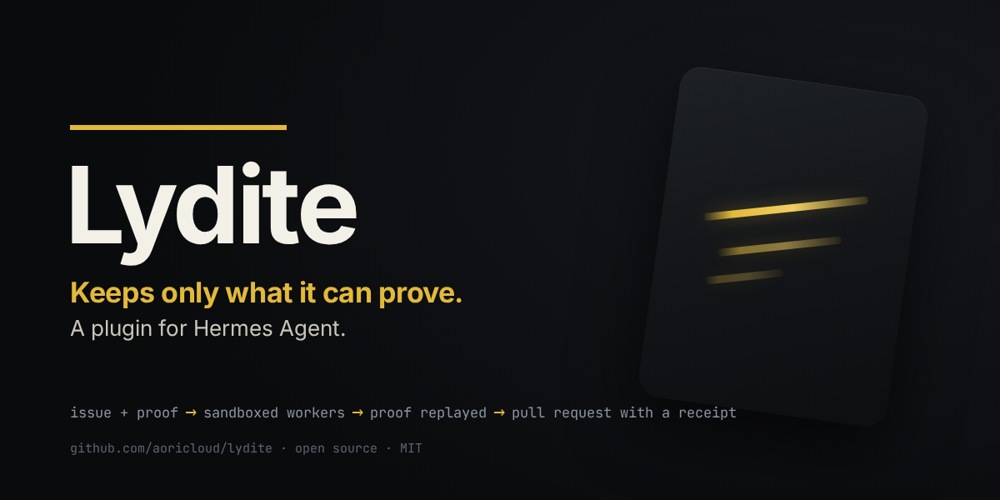
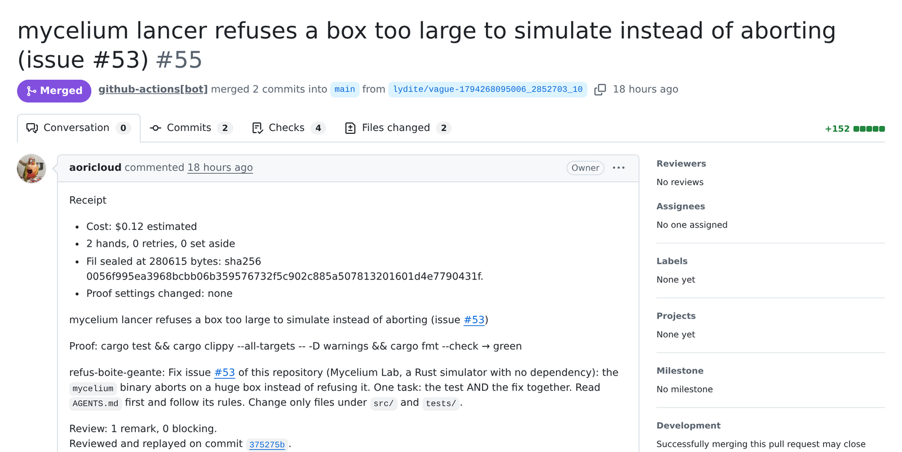
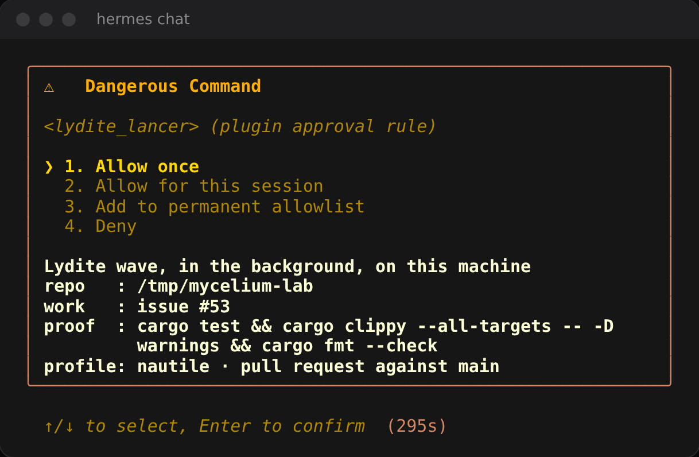

# lydite: a Hermes plugin



This plugin is a launcher. The engine is [Lydite](https://github.com/aoricloud/lydite), an open-source program (Rust,
MIT) that you install separately, from a release whose binary is built and attested by GitHub Actions.

From the chat you give an issue (or an objective, or a plan file), the **command that proves it done**, and a
repository. Lydite splits the work, runs one isolated Claude Code worker per task behind its sandbox wall, **replays
your proof itself** on every result, keeps only what passes, and opens a pull request that states the proof result and
the review outcome. Lydite itself never merges: what happens to the pull request is up to the repository, its humans
and its own merge rules.

## What comes back

A real one: [mycelium-lab#55](https://github.com/aoricloud/mycelium-lab/pull/55), the fix of issue #53 of a public
Rust simulator, started from a Hermes chat. Its receipt says $0.12 estimated, two workers, no retry, the proof
replayed green, and the commit that was reviewed and replayed. That repository merges a green pull request by its own
workflow, which is why GitHub shows it merged by `github-actions[bot]`.



## Before you start (about an hour)

- **Linux on x86-64.** Lydite's wall holds there only; elsewhere the tools do not appear.
- **The `lydite` binary**, from an attested release. **This plugin ships and downloads no binary.**

  ```bash
  gh release download --repo aoricloud/lydite --pattern 'lydite-*-linux-x86_64.tar.gz*'
  gh attestation verify lydite-*-linux-x86_64.tar.gz --repo aoricloud/lydite
  tar -xzf lydite-*-linux-x86_64.tar.gz
  mkdir -p ~/.local/bin && install -m 755 lydite-*-linux-x86_64/lydite ~/.local/bin/lydite
  ```

- **`git`, `gh` signed in** (2.67 or later for `gh attestation`), **Claude Code signed in**, and **`srt`** for the
  wall: [the table in Lydite's README](https://github.com/aoricloud/lydite#try-it) says how to install each.
- **A Lydite profile, written and accepted by a human** ([A profile](https://github.com/aoricloud/lydite#a-profile),
  then `lydite accepter <name>`). The plugin never accepts one.
- Hermes `>= 0.23.0`.

Without the binary, an accepted profile or `srt`, a launch is refused before anything starts, and the answer says
what is missing.

> If `lydite` is not on PATH, or if several programs could answer to that name, set the `binaire` setting to the
> absolute path of the right one.

## What it adds to Hermes

| Tool | What it does |
| --- | --- |
| `lydite_lancer` | Starts `lydite lancer <profile> --issue <n> --decouper --verifier "<proof>" --depot <repo> --pr main` in the background and returns at once with an id. Also takes `objectif` (instead of `issue`), `plan` (instead of both: a plan file written by hand, with its own models, files and `preuve :` line; see below), `profil`, `pr`, and `observer` (show the plan, build nothing). |
| `lydite_etat` | Returns `lydite etat` (what Lydite itself recorded: tasks, proofs, pull request, CI) and the launches made from this plugin, with the end of a launch's log when given its `id`. |
| `lydite_lecons` | Returns the lessons of a repository: the written rules Lydite learned there from past mistakes and gives to its workers, one per folder under `.agents/skills/<name>/SKILL.md`. Without `nom`, the list of each lesson's name, rule and files; with `nom`, one lesson in full. It is read-only, and Lydite checks the lessons first. Nothing is approved, because nothing is started or written. |
| `lydite_plan` | Runs `lydite plan <file>` on a plan file and returns what Lydite accepts or refuses, and why: the plan's SHA-256, its number of tasks, its proof line and the tasks that will wait for one another because they share a file, or Lydite's refusal (its code, its rule, what was seen, the fix). It starts nothing and costs nothing, so nothing is approved: use it to fix a plan with the human before approving a launch. |

It also ships one skill, `lydite:driving-lydite`, in the open `SKILL.md` format with only its common fields, so
Claude Code can read it too. It tells the model when to hand a job to Lydite, what to have before launching (the
repository, the work, your proof), how to read what `lydite_etat` returns (what Lydite observed against what a worker
only declared; what the cost line means), and to quote a refusal and stop rather than redo the work itself. Hermes
lists it for the model while the plugin is enabled, on Linux, and does not copy it into `~/.hermes/skills/`.

The workers are **Claude Code sessions that Lydite starts itself**, on the model and provider of the Lydite profile
(for example a DeepSeek endpoint). They are never Hermes agents or Hermes child processes.

### Names still in French

The tools answer in English, but some names you type are still French. Lydite 0.4.0 will give them English names.

| Name | Meaning |
| --- | --- |
| `lancer`, `etat`, `lecons` (in the tool names) | launch, state, lessons |
| `depot` | the repository: an absolute path to a git checkout |
| `objectif` | a one-line objective, instead of an issue |
| `preuve` | the proof: the command that shows the work done |
| `profil` | the Lydite profile |
| `pr` | the branch the pull request targets |
| `observer` | show the plan only, build nothing |
| `nom` | the name of one lesson |
| `binaire`, `cle_nom`, `cle` (settings) | the binary's path, the name of the provider key's variable, the provider key |

## Install and use

Copy this `hermes/` folder to `~/.hermes/plugins/lydite`; once the plugin is in the Hermes catalog,
`hermes plugins install lydite` does it for you. Then:

```bash
hermes plugins enable lydite
hermes config set plugins.entries.lydite.settings.binaire /home/you/lydite
hermes config set plugins.entries.lydite.settings.profil  my-profile
# only if the profile names a provider key (its `cle` line); the value goes to Hermes' own .env:
hermes config set plugins.entries.lydite.settings.cle_nom MY_PROVIDER_KEY
hermes config set LYDITE_CLE_FOURNISSEUR <the provider key>
```

Then, in the chat: "do issue 15 of /home/you/project, the proof is `cargo test && cargo clippy -- -D warnings`".
Or hand it a plan you wrote: "run the plan /home/you/plan.txt on /home/you/project". A plan names the model of each
task, which an issue cannot do reliably today (Lydite's planner chooses them); `lydite_plan` checks one without
running anything.

Hermes shows at most ten rows of an approval, and the plugin's message holds in nine: the repository, the work, the
proof, the profile and the target branch. A plan file is shown by its name, its size, its number of tasks, its proof
line and the SHA-256 of its bytes; Lydite runs those exact bytes, and the launch is refused if the file changed since
it was shown. Read the plan file before you approve: Hermes shows its name and its SHA-256, not its text. Check it
with `sha256sum <file>` to see the bytes Lydite will run. Hermes waits for your approval before anything starts.



## If the model does the work itself

By default Hermes hides plugin tools behind a `tool_search` step, and a model can miss them. The skill above tells
the model when to reach for Lydite, but it does not change how Hermes hides tools. Name Lydite in your request ("use
Lydite to run the plan ..."), or show the tools to the model directly:

```bash
hermes config set tools.tool_search.enabled off
```

## Settings

| Setting | Meaning |
| --- | --- |
| `binaire` | Absolute path of the Lydite binary. Empty: the first `lydite` on PATH. |
| `profil` | Default Lydite profile (default `claude`, Claude Code's own login). |
| `cle_nom` | Name of the environment variable the profile's `cle` line names (e.g. a provider key). Empty: no key is passed. |
| `cle` (secret `LYDITE_CLE_FOURNISSEUR`) | The provider key itself, set through Hermes. Read with `agent.secret_scope.get_secret`, handed only to the Lydite process. |

## Limits, said plainly

- Linux only. On Windows the wall is not held by Lydite; the tools do not appear.
- Lydite's proof is only as good as your command: a test that is wrong is replayed as faithfully as one that is right.
- Nothing comes back into the chat by itself: the plugin does not notify Hermes when a wave ends. Ask for the state
  with `lydite_etat`.
- The pull request body opens with a receipt written when the pull request is opened: the cost so far, the hands, the
  retries, the set-aside tasks and the proof-setting files the diff changed; then the proof result and the review
  outcome. `lydite_etat` returns what `lydite etat` prints, which has the same cost and hands line plus the wave's
  duration. The cost is an estimate, a flat-rate approximation or `inconnu` (unknown), never an invoice.

## What it does on your machine (disclosures)

- **Commands.** One program only: the Lydite binary, started with an argument list, never through a shell. `lydite
  lancer` (in the background), `lydite etat` (read-only, 30 s timeout), `lydite lecons <folder>` (read-only, 30 s
  timeout, with the closed list of variables and no provider key), and `lydite plan <file>` (read-only, 30 s timeout,
  with the closed list of variables and no provider key). Lydite in turn runs `git`, `gh`, `claude` and the proof
  command inside its sandbox; those are Lydite's, documented in its README.
- **Network.** The plugin makes no network call itself. Lydite and its workers do: the model provider named in the
  profile, and GitHub (through `gh`) for the issue, the push and the pull request. Nothing is sent anywhere else, and
  there is no telemetry.
- **Long-running process.** `lydite_lancer` starts one detached `lydite lancer` process (its own session, so it
  survives Hermes) that can run for minutes to hours. At most one per Lydite folder from this plugin. It writes its
  output to a log file under the plugin's data folder in `HERMES_HOME` (the last 20 launches are kept).
- **Secrets.** Only through Hermes: `get_secret("LYDITE_CLE_FOURNISSEUR")`, passed in the environment of the
  Lydite process under the variable named by `cle_nom`, and in no log, argument, state or tool result. The plugin
  never reads `.env`, `auth.json` or any key file.
- **Environment.** The Lydite process gets a closed list of variables (`PATH`, `HOME`, `LANG`, the `LYDITE_*` paths of
  the binary, `GH_CONFIG_DIR`, `CLAUDE_CONFIG_DIR`, ...), not the rest of Hermes' environment.
- **Approvals.** A `pre_tool_call` hook sends every `lydite_lancer` call to Hermes' human approval: at most ten rows,
  the plugin's message holding in nine, with the exact repository, work, proof, profile and target branch. A plan is
  shown by its file name, its size, its number of tasks, its proof line and the SHA-256 of its bytes, not its text.
  A request that would be refused anyway is answered without asking. "Always" only covers the same repository, profile
  and proof (or the same plan bytes). Nothing here disables a guard or reads the YOLO mode; in an unattended run
  Hermes' gate fails closed.
- **Files.** Reads nothing outside its own data folder except its own `skills/driving-lydite/SKILL.md` (when it
  registers the skill), what the Lydite binary reports, the `plan` file named in a `lydite_lancer` call (to
  fingerprint its bytes and copy them for Lydite) or in a `lydite_plan` call (to fingerprint its bytes and count its
  tasks), the lesson files of the repository named in a `lydite_lecons` call (`.agents/skills/*/SKILL.md`, 4096 bytes
  each at most, never following a link out of that folder), and the existence of the repository's `.git`. A plan is
  copied with mode 0600 under the plugin's data folder and Lydite reads the copy: if the file changed after you saw
  it, the launch is refused.

## Test

```bash
python3 -m unittest discover -s hermes/tests -t hermes
hermes plugins validate hermes --install-deps
```

The tests use only the standard library. They load the plugin by path, with a fake `ctx` and a fake `lydite`
script; the launch tests need Linux.

The program, its environment variables (`LYDITE_DOSSIER`, `LYDITE_SRT`, ...) and its state folder are all named
Lydite. The plugin's own name lives in `nom.py` and `plugin.yaml`, and `tests/test_manifeste.py` fails if the two
disagree.

## License

MIT.
