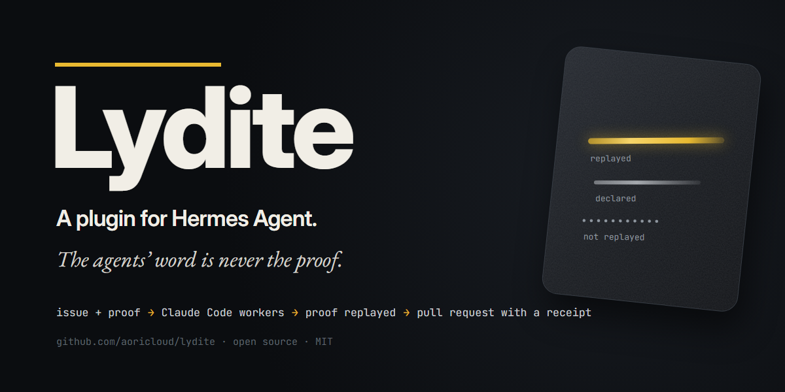
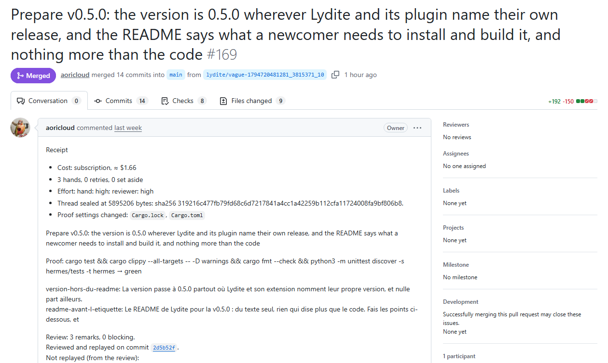
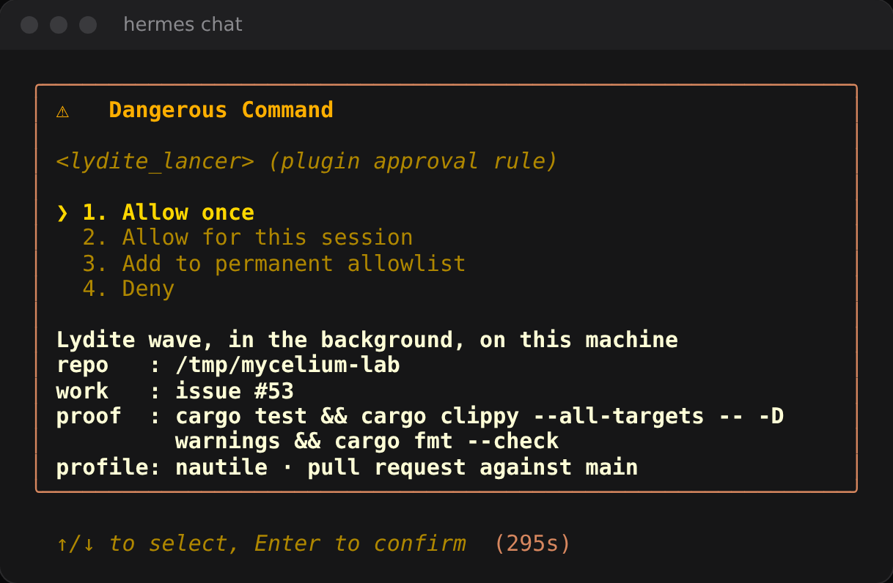

# lydite: a Hermes plugin



This plugin is a launcher. The engine is [Lydite](https://github.com/aoricloud/lydite), an open-source program (Rust,
MIT) that you install separately, from a release whose binary is built and attested by GitHub Actions.

From the chat you give an issue (or an objective, or a plan file), the **command that proves it done**, and a
repository. Lydite splits the work, runs one isolated Claude Code worker per task (each worker's Claude Code session runs on your
machine; only its commands are in Claude Code's sandbox, under a required wall, `exige` or `natif`; see "A requested
wall" below), **replays your proof itself** on every result, keeps only what passes, and opens a pull request that
states the proof result and the review outcome. Lydite itself never merges the pull request: what happens to it is up
to the repository, its humans and its own merge rules.

## What comes back

A real one: [mycelium-lab#55](https://github.com/aoricloud/mycelium-lab/pull/55), the fix of issue #53 of a public
Rust simulator, started from a Hermes chat. Its receipt says two workers, no retry, the proof replayed green,
and the commit that was reviewed and replayed. That repository merges a green pull request by its own
workflow, which is why GitHub shows it merged by `github-actions[bot]`.



## Before you start (about an hour)

- **Linux.** Lydite's wall holds there only: the tools appear under Linux only, whatever the architecture (the plugin
  checks the system, not the processor). The attested Lydite binary is for Linux x86-64.
- **The `lydite` binary**, from an attested release: this plugin lives in Lydite's repository and goes with the binary
  of the same release. **This plugin ships and downloads no binary.**

  ```bash
  gh release download --repo aoricloud/lydite --pattern 'lydite-*-linux-x86_64.tar.gz*'
  gh attestation verify lydite-*-linux-x86_64.tar.gz --repo aoricloud/lydite
  tar -xzf lydite-*-linux-x86_64.tar.gz
  mkdir -p ~/.local/bin && install -m 755 lydite-*-linux-x86_64/lydite lydite-*-linux-x86_64/lydite-reseau ~/.local/bin/
  ```

  `lydite-reseau` goes next to `lydite`: the native wall (`mur = natif`) looks for it there.

- **`git`, `gh` signed in** (2.67 or later for `gh attestation`), **Claude Code signed in**, and **`srt`** for the
  wall: [the table in Lydite's README](https://github.com/aoricloud/lydite#try-it) says how to install each.
- **A Lydite profile, written and accepted by a human** ([A profile](https://github.com/aoricloud/lydite#a-profile),
  then `lydite accept <name>`; the built-in `claude` profile is accepted too, by `lydite accept claude`). The plugin
  never accepts one.
- Hermes `>= 0.23.0`.

Without the binary, the plugin refuses the launch at once and the answer says what is missing. Without an accepted
profile or `srt`, Lydite itself refuses before any worker starts: `lydite_lancer` waits up to 3 seconds for such an
immediate refusal and gives it in its answer; if it comes later, it is at the end of the launch's log (`lydite_etat`
with the id).

> If `lydite` is not on PATH, or if several programs could answer to that name, set the `binaire` setting to the
> absolute path of the right one.

## What it adds to Hermes

| Tool | What it does |
| --- | --- |
| `lydite_lancer` | Starts `lydite lancer <profile> --issue <n> --decouper --verifier "<proof>" --depot <repo> --pr main` in the background and returns with an id: it first waits up to 3 seconds for an immediate refusal from Lydite, which is then in the answer, else at the end of the launch's log (`lydite_etat` with the id) (Lydite 0.5 still reads those French words as doubles of its English ones: `lydite launch ... --split --verify ...`). Also takes `objective` (instead of `issue`), `plan` (instead of both: a plan file written by hand, with its own models, files and `preuve :` line; see below), `profile`, `pr`, and `observe` (the hand that splits the work runs, then the plan is shown; no wave is built). |
| `lydite_etat` | Returns `lydite etat` (what Lydite itself recorded: tasks, proofs, pull request, CI) and the launches made from this plugin, with the end of a launch's log when given its `id`. |
| `lydite_lecons` | Returns the lessons of a repository: the written rules Lydite learned there from past mistakes and gives to its workers, one per folder under `.agents/skills/<name>/SKILL.md`. Without `name`, the list of each lesson's name, rule and files; with `name`, one lesson in full. It is read-only, and Lydite checks the lessons first. Nothing is approved, because nothing is started or written. |
| `lydite_plan` | Runs `lydite plan <file>` on a plan file and returns what Lydite accepts or refuses, and why: the plan's SHA-256, its number of tasks, its proof line and the tasks that will wait for one another because they share a file, or Lydite's refusal (its code, its rule, what was seen, the fix). It starts nothing and costs nothing, so nothing is approved: use it to fix a plan with the human before approving a launch. |
| `lydite_findings` | Runs `lydite findings` (read-only, and nothing else) on a hermes-security findings export (JSON, `1.0`) and turns it into Lydite plans. It needs a Lydite binary that has `lydite findings`, newer than 0.4.0. Without `ids`, it lists the findings Lydite can take and the ones it sets aside, each with the reason (the plugin also sets aside a finding that cites a file which is not in the repository). With `ids` (from 1 to 12) and `proof`, it writes one plan file per chosen finding, as Lydite wrote it, under the plugin's data folder (mode 0600), and starts nothing, so nothing is approved. It saves a plan only if its header carries the `report` line of that scan and finding. It is launched like any plan, with `lydite_lancer`, after the human's approval; Lydite refuses a plan that carries the `report` line unless the profile requires the wall (6037; see below). |

It also ships one skill, `lydite:driving-lydite`, in the open `SKILL.md` format with only its common fields (`name`, `description`, `license`, `compatibility`), so
Claude Code can read it too. It tells the model when to hand a job to Lydite, what to have before launching (the
repository, the work, your proof), how to read what `lydite_etat` returns (what Lydite observed against what a worker
only declared; what the cost line means), and to quote a refusal and stop rather than redo the work itself. Hermes
lists it for the model while the plugin is enabled, on Linux, and does not copy it into `~/.hermes/skills/`. The Lydite
binary carries the same skill, and `lydite skill` writes it, for an agent outside Hermes.

The workers are **Claude Code sessions that Lydite starts itself**, on the model and provider of the Lydite profile
(for example a DeepSeek endpoint). They are never Hermes agents or subagents: the plugin starts only `lydite`, and
Lydite starts the workers.

### With hermes-security

`lydite_findings` is for the findings of a hermes-security scan. The steps:

1. hermes-security scans the repository and exports the scan as JSON
   (`hermes security-review export --scan <id> --format json --out <file>`).
2. `lydite_findings` with the repository and that file lists the findings Lydite can take and the ones it sets aside.
3. The human chooses which findings to fix, and gives the proof command.
4. `lydite_findings` writes one plan per chosen finding. Each plan asks the worker to prove the flaw by a failing test
   first, then fix it.
5. Each plan is launched by `lydite_lancer`, one at a time, and the human approves each launch.
6. Lydite opens the pull request and its receipt, as for any launch.

A finding that comes back **not proved** is the worker's word that no test could show it: nothing was changed, and the
worker says so instead of fixing blind. Lydite does not verify that word, so it is for the human to judge. What is
proved today: a plan from `lydite_findings` carries `red : declared`, and the hand names its test file (`RED: <file>`).
Lydite itself replays the proof on the base plus that one file and requires it to fail, then requires it to pass with
the whole change. The reviewer reads the reason for the red (a compile error counts as a failure). A finding under
`.github/` (or `.git/`, `.claude/`) goes back to the human: Lydite does not publish changes there.

The format read is the `1.0` JSON export of hermes-security. Lydite reads that format with its own reader.

The titles and claims of a report are text written by someone else. They enter the worker's instruction quoted as
data, bounded and on one line. The plan that `lydite_findings` writes carries its origin, a `report` line, and Lydite
itself refuses a plan that carries that line (6037) unless the profile requires the wall. That is all that holds: a plan
whose `report` line was removed, or one written by hand from a report, goes as a plan written by hand, and the human's
reading of the plan before approving is what holds. The approval message says the origin of a plan, `report <scan>
<id>` or `none (written by hand)`. To use a plan that carries the line, put `mur = exige` in the profile, and have a
human run `lydite accept <name>`; or use another profile.

### Names still in French

The tools' own messages are in English, and their arguments have English names. What Lydite prints and the tools relay
is partly in French: the progress lines of a launch, the `seen` and `fix` of some refusals, and the
`added_dependencies` lines of `lydite_plan`. A few names are still French in this version: the
tools `lydite_lancer`, `lydite_etat` and `lydite_lecons`, and the settings `binaire`, `profil`, `cle_nom` and `cle`
keep their French names.

| Name | Meaning |
| --- | --- |
| `lancer`, `etat`, `lecons` (in the tool names) | launch, state, lessons |
| `binaire`, `profil`, `cle_nom`, `cle` (settings) | the binary's path, the default Lydite profile, the name of the provider key's variable, the provider key |

The earlier French argument names still work as aliases: `depot` (`repo`), `objectif` (`objective`), `preuve`
(`proof`), `profil` (`profile`), `observer` (`observe`) and `nom` (`name`).
Giving both names of one argument is refused.

## Install and use

The plugin is listed as a community plugin in the Hermes plugin catalog: `hermes plugins install lydite` installs
the release the catalog pins. Or copy this `hermes/` folder to `~/.hermes/plugins/lydite`. Then:

```bash
hermes plugins enable lydite
hermes config set plugins.entries.lydite.settings.binaire /srv/lydite/bin/lydite
hermes config set plugins.entries.lydite.settings.profil  my-profile
# only if the profile names a provider key (its `cle` line); the key itself goes to Hermes' own .env (see the paragraph below):
hermes config set plugins.entries.lydite.settings.cle_nom MY_PROVIDER_KEY
```

If the profile names a provider key (its `cle` line), set that key without typing it as an argument: a key typed on
the command line stays in the shell history and shows in the process list. Open Hermes' `.env` file in an editor and
add the line `LYDITE_CLE_FOURNISSEUR=<the provider key>`. Hermes only sets the `.env` file to mode 0600 when it
writes the file itself, and a file created by your editor gets the umask's permissions, often readable by the other
accounts on the machine; so create the file, set it to 600, then open it (the editor keeps the mode of a file that
already exists):

```bash
f="$(hermes config env-path)"
touch "$f" && chmod 600 "$f"
"${EDITOR:-nano}" "$f"
```

If a secrets manager is already connected to Hermes, use `hermes secrets` instead.

Then, in the chat: "do issue 15 of /srv/project, the proof is `cargo test && cargo clippy -- -D warnings`".
Or hand it a plan you wrote: "run the plan /srv/plan.txt on /srv/project". A plan names the model of each
task, which an issue cannot do reliably today (Lydite's planner chooses them); `lydite_plan` checks one without
running anything. The only proof of a plan is the one in its header, and a plan whose task carries its own `preuve :`
line is refused, because Lydite would run the task's proof, which the human is not shown.

Hermes shows at most ten rows of an approval, and the plugin's message holds in nine: the repository, the work, the
proof, the profile and the target branch (with `observe`, the branch row says `plan only`). A plan file is shown by its
name, its size, its number of tasks, its origin, its proof line and the SHA-256 of its bytes; Lydite runs those exact
bytes, and the launch is refused if the file changed since it was shown. Read the plan file before you approve: Hermes shows its name and its SHA-256, not its text. Check it
with `sha256sum <file>` to see the bytes Lydite will run. Hermes waits for your approval before anything starts.



## If the model does the work itself

By default Hermes hides plugin tools behind a `tool_search` step, and a model can miss them. The skill above tells
the model when to reach for Lydite, but it does not change how Hermes hides tools. Name Lydite in your request ("use
Lydite to run the plan ..."), or show the tools to the model directly:

```bash
hermes config set tools.tool_search.enabled off
```

## Settings

| Setting | Meaning |
| --- | --- |
| `binaire` | Absolute path of the Lydite binary. Empty: the first `lydite` on PATH. |
| `profil` | Default Lydite profile (default `claude`, Claude Code's own login; the built-in profile is accepted too, by `lydite accept claude`). |
| `cle_nom` | Name of the environment variable the profile's `cle` line names (e.g. a provider key). Empty: no key is passed, which is right only for a profile with no `cle` line (otherwise Lydite refuses, 6027). |
| `cle` (secret `LYDITE_CLE_FOURNISSEUR`) | The provider key itself, set through Hermes. Read with `agent.secret_scope.get_secret`, handed only to the Lydite process. |

## Limits, said plainly

- Linux only. On Windows the wall is not held by Lydite; the tools do not appear.
- Lydite's proof is only as good as your command: a test that is wrong is replayed as faithfully as one that is right.
- A plan born from a report is held to a required wall only while it carries the `report` line that `lydite_findings`
  writes (Lydite refuses it otherwise, 6037). A plan whose line was removed, or written by hand from a report, goes as
  a plan written by hand: the human's reading of the plan before approving is what holds.
- Nothing comes back into the chat by itself: the plugin does not notify Hermes when a wave ends. Ask for the state
  with `lydite_etat`.
- The pull request body opens with a receipt written when the pull request is opened: the cost so far, the hands, the
  retries, the set-aside tasks and the proof-setting files the diff changed; then the proof result and the review
  outcome. `lydite_etat` returns what `lydite etat` prints, which has the same cost and hands line plus the wave's
  duration. The cost is an estimate, a flat-rate approximation or `unknown`, never an invoice.

## What it does on your machine (disclosures)

- **Commands.** One program only: the Lydite binary, started with an argument list, never through a shell. `lydite
  lancer` (in the background), `lydite etat` (read-only, 30 s timeout), `lydite lecons <folder>` (read-only, 30 s
  timeout, with the closed list of variables and no provider key), and `lydite plan <file>` (read-only, 30 s timeout,
  with the closed list of variables and no provider key), and `lydite findings <report>` (read-only, 30 s timeout,
  same closed list; with `--plan <id> --verify <proof>` it writes a plan on its standard output, which the plugin saves;
  it starts no wave). The plugin starts these French words; Lydite 0.5
  still reads them as doubles of its English ones (`launch`, `status`, `lessons`). Lydite in turn runs `git`, `gh` and the `claude`
  process on the host, with your GitHub login; only the commands of a hand run in Claude Code's sandbox, and the proof
  command is replayed in the wall (by srt under `mur = exige`, by Lydite's native wall under `mur = natif`); those are
  Lydite's, documented in its README.
- **A requested wall.** A profile accepted with `mur = demande` leaves this: the commands of a hand may run outside
  Claude Code's sandbox and see the provider's key if there is one, and the proof is replayed on the host, outside the
  wall. A required wall (`exige`, the default, or `natif`) is required for `--issue` and, by Lydite's refusal 6037,
  for a plan that carries the `report` line that `lydite_findings` writes; a plan without that line is not held to it.
- **Network.** The plugin makes no network call itself. Lydite and its workers do: the model provider named in the
  profile, and GitHub (through `gh`) for the issue, the push and the pull request. Nothing is sent anywhere else, and
  there is no telemetry.
- **Long-running process.** `lydite_lancer` starts one detached `lydite lancer` process (its own session, so it
  survives Hermes) that can run for minutes to hours. At most one per Lydite folder from this plugin. It writes its
  output to a log file under the plugin's data folder (the one Hermes gives the plugin, or, without it,
  `<temporary folder>/lydite`; the last 20 launches are kept).
- **Secrets.** Only through Hermes: `get_secret("LYDITE_CLE_FOURNISSEUR")`, passed in the environment of the
  Lydite process under the variable named by `cle_nom`, and in no log, argument, state or tool result. The plugin
  never reads `.env`, `auth.json` or any key file.
- **Environment.** The Lydite process gets a closed list of variables (`PATH`, `HOME`, `LANG`, the `LYDITE_*` paths of
  the binary, `GH_CONFIG_DIR`, `CLAUDE_CONFIG_DIR`, ...), not the rest of Hermes' environment. Started from Hermes,
  the native wall takes `bwrap` from `LYDITE_BWRAP` or the `PATH`, and `lydite-reseau` from `LYDITE_RESEAU` or next
  to the `lydite` binary; the plugin passes these two variables, as it passes `LYDITE_SRT`.
- **Approvals.** A `pre_tool_call` hook sends every `lydite_lancer` call to Hermes' human approval: at most ten rows,
  the plugin's message holding in nine, with the exact repository, work, proof, profile and target branch (`plan only`
  instead of the branch with `observe`). A plan is
  shown by its file name, its size, its number of tasks, its origin (`report <scan> <id>` if its header carries a
  well-formed `report` line, else `none (written by hand)`), its proof line and the SHA-256 of its bytes, not its text.
  A request that would be refused anyway is answered without asking. "Always" only covers the same repository, profile,
  issue, objective, target branch, mode (a dry run with `observe` or a real launch) and proof (or the same plan
  bytes). Nothing here disables a guard or reads the YOLO mode; in an unattended run
  Hermes' gate fails closed.
- **Files.** Reads nothing outside its own data folder except its own `skills/driving-lydite/SKILL.md` (when it
  registers the skill), what the Lydite binary reports, `/proc/<pid>/cmdline` of a launch it made (to tell whether that
  launch still runs), the `plan` file named in a `lydite_lancer` call (to
  fingerprint its bytes and copy them for Lydite) or in a `lydite_plan` call (to fingerprint its bytes and count its
  tasks), the lesson files of the repository named in a `lydite_lecons` call (`.agents/skills/*/SKILL.md`, 4096 bytes
  each at most, never following a link out of that folder), the report file named in a `lydite_findings` call (4 MiB
  at most) and the files of the repository that the report cites (only their existence is looked at), and the
  existence of the repository's `.git`. A plan is copied with mode 0600 under the plugin's data folder and Lydite
  reads the copy: if the file changed after you saw it, the launch is refused.
- **File writes.** The plans written by `lydite_findings`, mode 0600, under the plugin's data folder, and nothing
  anywhere else (apart from the logs and plan copies of launches, in the same folder).
- **Third-party text.** The titles and the claims of a report enter a worker's instruction, quoted as data, bounded
  and without a line break. Lydite refuses, unless the wall is required (6037), a plan that carries the `report` line
  that `lydite_findings` writes; a plan whose line was removed, or written by hand from a report, goes as a plan
  written by hand, and the human's reading of the plan before approving is what holds.

## Test

```bash
python3 -m unittest discover -s hermes/tests -t hermes
hermes plugins validate hermes --install-deps
```

The tests use only the standard library. They load the plugin by path, with a fake `ctx` and a fake `lydite`
script; the launch tests need Linux.

The program, its environment variables (`LYDITE_DOSSIER`, `LYDITE_SRT`, ...) and its state folder are all named
Lydite. Started from Hermes, the native wall takes `bwrap` from `LYDITE_BWRAP` or the `PATH`, and `lydite-reseau`
from `LYDITE_RESEAU` or next to the `lydite` binary; the plugin passes these two variables, as it passes `LYDITE_SRT`. The plugin's own name lives in `nom.py` and `plugin.yaml`, and `tests/test_manifeste.py` fails if the two
disagree.

## License

MIT.
